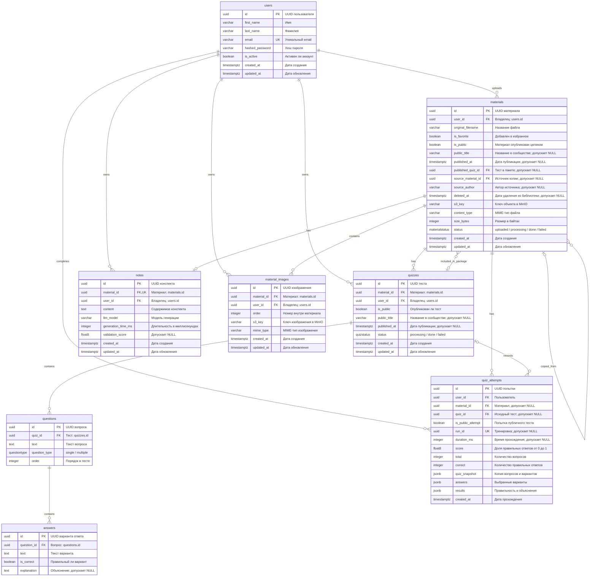

# Схема базы данных

В PostgreSQL хранятся пользователи, лекции, конспекты и тесты.
Файлы и картинки лежат в MinIO, сессии и очередь задач в Redis.
Там же 30 минут хранятся хеши одноразовых ссылок восстановления пароля.

На диаграмме показаны все поля и связи. PK означает первичный ключ,
FK означает ссылку на другую таблицу, UK означает уникальное значение.

## Как это устроено

- `users`: аккаунты пользователей.
- `materials`: загруженные лекции. В таблице хранится информация о файле и его ключ в MinIO.
- `notes`: конспект лекции. У одной лекции может быть только один конспект.
- `material_images`: картинки из лекции. Номер картинки уникален внутри лекции.
- `quizzes`: тесты по лекции. У одной лекции может быть несколько тестов.
- `questions`: вопросы теста. Тип `single` означает один правильный ответ, `multiple` означает несколько.
- `answers`: варианты ответов, отметка правильности и объяснение.
- `quiz_attempts`: завершённые попытки с датой, оценкой, вопросами и выбранными ответами.

## Что важно знать

NULL допускается в `validation_score`, `explanation`, `materials.deleted_at`,
`quizzes.public_title`, `quizzes.published_at`, `quiz_attempts.quiz_id`,
`quiz_attempts.material_id`, `quiz_attempts.run_id` и `quiz_attempts.duration_ms`.
У `materials` также допускают NULL поля `public_title`, `published_at`,
`published_quiz_id`, `source_material_id` и `source_author`.
UUID создаёт приложение. Поля `created_at` и `updated_at` хранят время создания и обновления.
У вопросов и вариантов ответов этих дат нет.

При удалении пользователя удаляются связанные записи в БД.
При удалении лекции удаляются её конспект, картинки и тесты.
Файлы в MinIO нужно удалять отдельно.

Количество вопросов и правильных ответов проверяет приложение.
История сохраняется в `quiz_attempts`. В ней есть копия теста, выбранные варианты
и объяснения ошибок. Поэтому старую попытку можно открыть даже после изменения
или удаления исходного теста. При удалении теста `quiz_id` становится NULL.
При удалении участника удаляются его попытки. Удаление автора или лекции
не удаляет сохранённые публичные попытки других участников.
Для списка попыток есть индекс по пользователю, материалу и дате.
У попытки есть `created_at`, но нет `updated_at`.

Избранное хранится в `materials.is_favorite`. Удаление из библиотеки устанавливает
`deleted_at`: материал и связанные данные больше не выдаются через API.
Строки и файлы при этом остаются в хранилище.

Схема соответствует миграции `b6e1f4a8c015`.
Исходники: [модели](../app/models/) и [миграции](../alembic/versions/).

Публичность задаётся у конкретного теста полем `quizzes.is_public`.
Лекция и конспект от этого публичными не становятся.
У публичной попытки `user_id` указывает на участника, а не на автора теста.
При физическом удалении материала ссылка `quiz_attempts.material_id` становится NULL.
Сохранённые копии публичных попыток остаются у участников.

В сообществе публикуется весь материал: исходный файл, конспект, картинки
и готовый тест, если он есть. Публикация требует отдельного подтверждения владельца.
`materials.published_quiz_id` указывает на тест, включённый в пакет.
Кнопка «Обновить пакет» выбирает последний готовый тест.

При импорте создаются новые записи и отдельные объекты в MinIO.
Копия остаётся закрытой, результаты прохождений в неё не переносятся.
`source_material_id` и `source_author` сохраняют происхождение материала.
Частичный уникальный индекс `(user_id, source_material_id)` запрещает повторный
импорт активной копии. После удаления копии её можно импортировать снова.

Для тренировки на время сервер хранит в Redis начало и `run_id`.
Страница подтверждает активность каждые 30 секунд; без подтверждения попытка
истекает через 2 минуты. Закрытие страницы отправляет отмену, новый старт
заменяет незавершённую попытку. Прерванные попытки не попадают в рейтинг.
При завершении сохраняется `duration_ms`, уникальный `run_id` защищает
от повторного сохранения. Старые результаты без времени не раскрываются.
